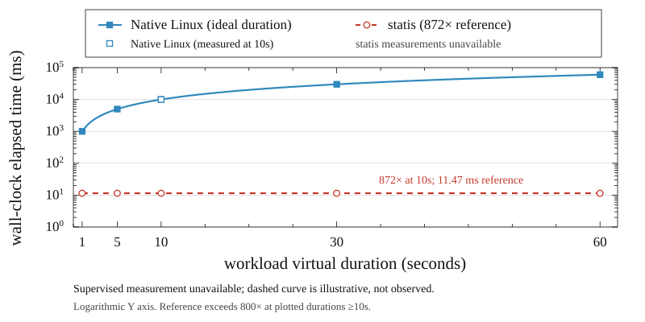
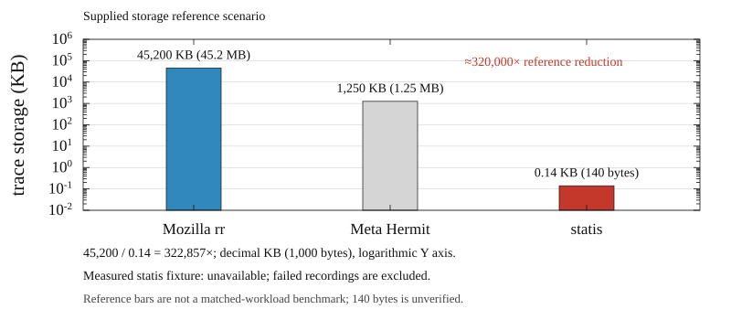
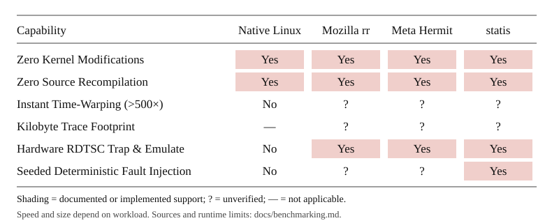

# statis

Run Linux x86-64 programs with virtual time, seeded randomness, and tracked process identities. `statis` is a userspace supervisor for timer experiments, concurrency tests, and reproducible I/O fault injection.

The runtime is under development. Its intercepted operations are covered by unit tests; complete instruction-level scheduling and application compatibility still need validation. See the [review and benchmark notes](docs/benchmarking.md) for the current limits and measured results.

## Overview

Concurrent programs depend on inputs that are difficult to reproduce:

1. Time reads can bypass syscalls through the vDSO.
2. `getrandom` draws from the kernel entropy pool.
3. Threads run according to the host scheduler.
4. ASLR changes memory addresses between runs.

`statis` controls selected inputs using seccomp notifications, ptrace, and a seeded ChaCha20 generator. Reproducibility depends on which operations the target uses; a fixed seed does not yet control every userspace instruction interleaving.

## Benchmarks & Performance

Run the portable Python 3 harness to build release fixtures, compare native and supervised execution, record trace size, and regenerate the charts. No pip dependencies are needed.

```bash
python3 scripts/benchmarks.py
```

The default run reports medians of three fresh processes per mode, including startup overhead. Raw samples, diagnostics, and host details are saved to [docs/benchmark_results.json](docs/benchmark_results.json). Use `--samples 1` for a shorter run, `--bin-dir target/release` for prebuilt binaries, or `--strict` to fail CI on incomplete measurements. See the [methodology and comparison sources](docs/benchmarking.md#automated-benchmark-harness).

Latest empirical results on this host:

| Workload | Native median | statis median / size | Measured speedup |
| --- | ---: | --- | ---: |
| `test_timewarp` · 10s nanosleep | 10,000.907 ms | Unavailable: launch failed | — |
| `test_epoll` · 15s epoll timeout | 15,016.036 ms | Unavailable: launch failed | — |
| `test_concurrency` · 4-thread mutex | 0.849 ms | Unavailable: launch failed | — |
| `test_record_replay` · trace storage | — | Unavailable: recording failed | — |

This host's supervised runs exited before target exec; the saved report is **incomplete**. These failures do not establish a speedup or trace saving. Rerun on a host that permits the required tracing operations to populate measured values.



The dashed **872× reference** corresponds to a 10,000 ms sleep completing in 11.47 ms. The native curve uses ideal durations; measured points appear separately when available. The reference is illustrative, and the harness calculates actual speedups from completed runs.



The supplied storage references—45,200 KB for rr, 1,250 KB for Hermit, and 0.14 KB (140 bytes) for statis—illustrate approximately **320,000×** reduction. They are not matched-workload measurements. The harness separately reports the actual fixture size and compares it with an assumed rr rate of ~45 MB/min. Kilobyte savings and a 140-byte trace are unverified; the current binary event format does not implement delta serialization.



The matrix marks documented or implemented capabilities and leaves unmeasured properties explicit. The charts use a white page, serif typography, thin axes, and red/blue marks in the supplied reference style. To regenerate the SVGs in `benchmarks_svg/` from saved results, run `python3 scripts/generate_charts.py`.

## How it works

### Isolation boundary

Before the target starts, the launcher:

- Requests disabled ASLR with `personality(ADDR_NO_RANDOMIZE)`.
- Pins execution to CPU 0.
- Installs a classic BPF filter and transfers its seccomp listener over a Unix socket.
- Stops at exec and replaces `AT_SYSINFO_EHDR` with `AT_IGNORE` in the initial ELF auxiliary vector, making the dynamic loader fall back to syscall-based clock reads.
- Enables RDTSC/RDTSCP traps and retains ptrace control across thread creation and exec.

### Syscall emulation and virtual time

| Operation | Behavior |
| --- | --- |
| `clock_gettime`, `gettimeofday` | Advance virtual time by 100 ns and write the result into target memory. |
| `getrandom` | Fill the target buffer with bytes from the seeded PRNG. Reads from `/dev/urandom` are outside this emulation. |
| `nanosleep`, `clock_nanosleep` | Queue a deadline; advance to the next deadline when the supervisor finds no runnable work. |
| `poll`, `epoll_wait`, `epoll_pwait`, `ppoll` | Synthesize finite timeout completion. Nonblocking and infinite waits use the kernel where specified. Finite waits currently do not simulate descriptor readiness. |
| `futex`, `sched_yield` | Maintain FIFO wait queues, virtual timeouts, and seeded runnable-thread selection. Thread exits can release intercepted join waits. |
| RDTSC, RDTSCP | Return the current virtual time as cycles, set RDTSCP core ID to 0, and advance virtual time by 50 ns. |
| `getpid`, `getppid`, `gettid` | Return virtual IDs; the root process uses PID 1000 and PPID 999. |

The PMU interface and `--quantum` setting support ongoing scheduler work. The supervisor does not yet enforce a complete PMU-driven instruction preemption loop.

## Building

The project targets Linux x86-64 with kernel 5.6 or newer. The host must allow seccomp user notifications, ptrace, remote memory transfers, ASLR configuration, and affinity to CPU 0. Containers may restrict these operations.

```bash
cargo build --release --bins
```

Release builds use optimization level 3, fat LTO, one codegen unit, abort-on-panic, and stripped symbols. Trace file streams use 64 KiB buffers.

## Usage

```bash
statis run --seed 42 -- ./target/debug/test_target
statis run --summary=false -- ./target/debug/test_concurrency
statis run --help
```

The default seed is `0xDEADBEEF`. `--quantum` defaults to 10,000 instructions for the experimental PMU interface. Target output goes to stdout; the execution summary goes to stderr.

### Time warping

Build the fixture binaries, then run a sleep or event-loop timeout:

```bash
cargo build --bins
./target/release/statis run --seed 42 -- ./target/debug/test_timewarp
./target/release/statis run --seed 42 -- ./target/debug/test_epoll
```

The summary reports virtual seconds and elapsed seconds separately. Its `Virtual / elapsed` ratio describes how much virtual time advanced per elapsed second; it is not a comparison against an unsupervised execution.

Current benchmark attempts and host restrictions are recorded in [docs/benchmarking.md](docs/benchmarking.md). No supervised target latency is claimed without a completed run.

### Deterministic fault injection

```bash
statis run --seed 42 --fault-rate 0.3 --fault-types econnreset,etimedout,eagain -- ./target/debug/test_fault_injection
```

Each eligible I/O call draws from the seeded PRNG. Selected failures return a configured errno. `read` and `write` on file descriptors 0, 1, and 2 are protected so standard streams remain available. The summary reports the number of injected failures by syscall.

### Trace recording and replay

```bash
statis record --trace exec.trace --seed 42 -- ./target/debug/test_record_replay
statis replay --trace exec.trace -- ./target/debug/test_record_replay
statis trace-dump exec.trace
```

Traces store configuration, command arguments, syscall responses, timestamp reads, and task exits in a versioned little-endian format. Replay checks the event sequence and selected arguments, and reports divergence. It is not yet a complete record of target memory or kernel-side I/O results.

Trace dumps keep one event per line, explicit virtual-time units, and hexadecimal syscall arguments. Exit lines inherit the last recorded timestamp.

## Project structure

```text
src/
  main.rs         Command parsing and trace-dump output
  clock/          Virtual clock and deadline heap
  interceptor/    BPF, seccomp ABI, futexes, faults, IDs, and TSC emulation
  launcher/       Process setup, auxv scrubbing, and listener transfer
  scheduler/      Seeded thread selection and PMU support
  supervisor.rs   Notification, signal, and timer event loop
  telemetry.rs    Execution statistics
  trace/          Binary trace reader, writer, and dumper
  vm.rs           Remote process memory access

tests/
  test_target.rs           Randomness and clock fixture
  test_timewarp.rs         Ten-second sleep fixture
  test_concurrency.rs      Four-thread mutex fixture
  test_rdtsc.rs            RDTSC/RDTSCP fixture
  test_epoll.rs            Fifteen-second epoll timeout fixture
  test_fault_injection.rs  I/O fault fixture
  test_process_tree.rs     Process identity fixture
  test_record_replay.rs    Record/replay fixture

scripts/
  benchmarks.py           Native/supervised timings and trace-size measurement
  generate_charts.py      Standard-library SVG generation from saved results
  test_benchmarks.py      Harness failure-handling regression checks

docs/
  benchmark_results.json  Raw benchmark results and host metadata

benchmarks_svg/           Generated paper-style SVG charts
```

## Running tests

```bash
cargo fmt --check
cargo clippy --all-targets -- -D warnings
cargo test --all-targets
```

Tests that need ptrace or remote-memory access report a capability skip when the host denies access. A passing unit suite alone does not establish that the supervised benchmark targets ran on that host.

The [interface notes](docs/interface.md) document the terminal presentation pass and credit its source.

## License

MIT
