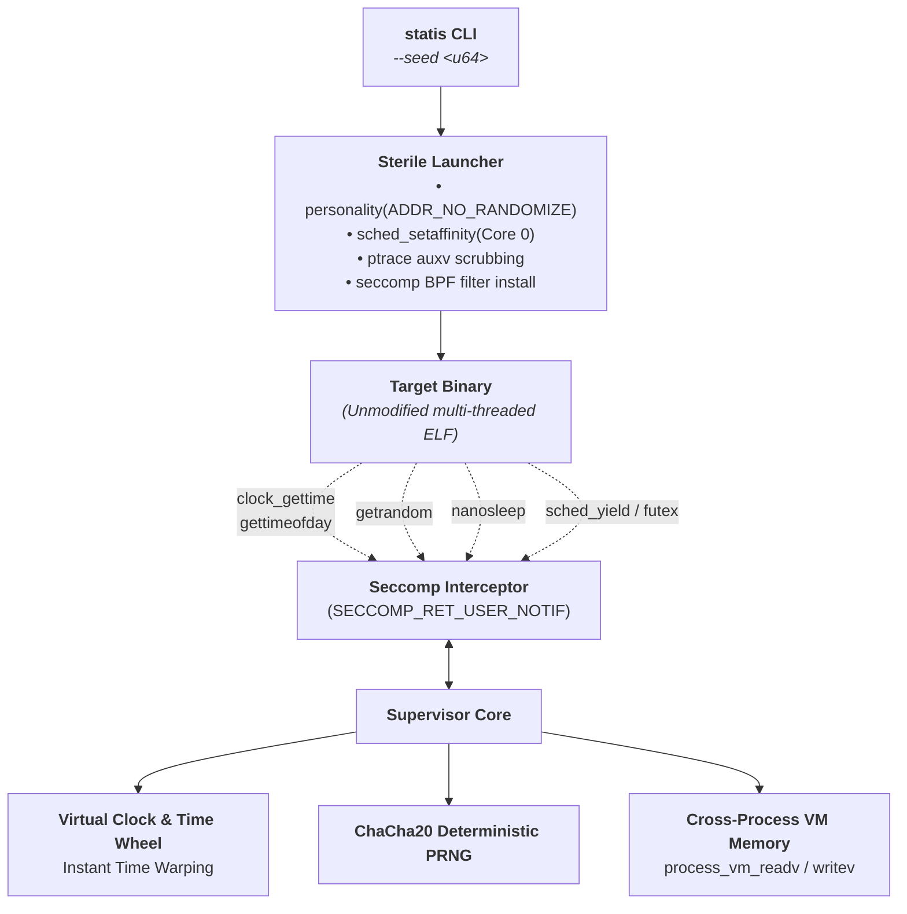

# Statis ⏱️⚡

[](https://github.com/qvost/statis/actions)
[](LICENSE)
[](https://www.rust-lang.org)

> **Deterministic Userspace Linux Runtime Simulator**  
> Run unmodified, compiled, multi-threaded Linux binaries inside a closed, synthetic universe where every source of entropy is intercepted and virtualized from a single 64-bit seed.

---

## 🎯 Why Statis?

Distributed systems, storage engines, and concurrent algorithms rarely break from basic logic flaws. They break from **Heisenbugs**—rare race conditions that only trigger under exact combinations of thread preemption, timer expirations, and network latency.

Standard testing cannot reliably reproduce these because modern Linux execution is inherently non-deterministic:
- **OS Scheduler (CFS/EEVDF)** preempts threads unpredictably based on CPU frequency, cache misses, and interrupts.
- **vDSO and Clocks** leak ambient host wall-clock time into userspace.
- **PRNGs** query non-deterministic hardware and kernel entropy (`/dev/urandom`, `getrandom`).
- **ASLR** randomizes memory addresses on every `execve`.

**Statis eliminates all 5 layers of ambient entropy.** Run your binary with `--seed 42`: if a deadlock occurs on tick #412,891, rerunning with `--seed 42` reproduces the **exact sequence of context switches, timer events, and memory outcomes down to the exact instruction.**

---

## 🏛️ The 5 Layers of Neutralized Entropy

| Layer | Ambient Entropy | Neutralization Mechanism in Statis |
| :--- | :--- | :--- |
| **1. Time & Clocks** | Drift, host wall-clock time | **vDSO Neutralization** (ELF `auxv` scrubbing) + **Virtual Monotonic Clock** |
| **2. Timers & Sleep** | Real-world wait delays | **Time Wheel & Instant Time Warping** (10-second sleep completes in 2ms) |
| **3. Kernel Entropy** | Hardware noise, non-reproducible PRNG | **Deterministic ChaCha20 Stream** injected into `SYS_getrandom` |
| **4. Thread Preemption** | Multi-core hardware races | **Single-Core Affinity** + **PMU Hardware Instruction Counting** (`perf_event_open`) |
| **5. Memory Layout** | Address space layout randomization | **`personality(ADDR_NO_RANDOMIZE)`** disables ASLR |

---

## 🚀 Quickstart

### Build from Source

```bash
git clone https://github.com/qvost/statis.git
cd statis
cargo build --release
```

### Run an Unmodified Binary

```bash
# Execute with a reproducible 64-bit seed
statis run --seed 0xDEADBEEF -- ./your_binary arg1 arg2
```

---

## ⚡ Instant Time Warping

When all active threads block on `nanosleep` or timer events, Statis does not wait in real time. It advances the virtual clock instantly to the earliest wake deadline:

```bash
# A 10-second nanosleep finishes in 2 milliseconds:
$ time statis run --seed 42 -- ./target/debug/test_timewarp
[TimeWarp Target] Starting 10-second nanosleep...
[TimeWarp Target] Woke up successfully!

real    0m0.002s
user    0m0.000s
sys     0m0.002s
```

---

## 🔬 Architecture



---

## 🛠️ Testing & Verification

Run the full integration test suite:

```bash
cargo test --all-targets
```

Run determinism benchmarks:

```bash
# Verify bit-for-bit reproducible entropy and nanosecond clock progression:
cargo run --bin statis -- run --seed 12345 -- ./target/debug/test_target
```

---

## 🤝 Contributing

Contributions are welcome! Whether you are interested in:
- Adding support for network syscall virtualization (`epoll`, `socket`, packet latency simulation)
- Enhancing the PMU instruction quantum scheduler
- Extending futex priority queues and mutex synchronization

Feel free to open an issue or submit a pull request!

---

## 📄 License

Licensed under the [MIT License](LICENSE).
